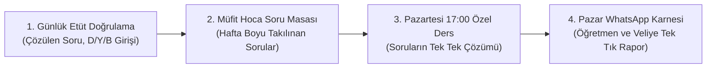

# FATMA ÖZMİL - 1. AŞAMA (2026-2027) AKADEMİK ÇALIŞMA PROGRAMI VE DENEME SINAVI ANALİZ KILAVUZU

**Öğrenci:** Fatma ÖZMİL  
**Hedef:** YKS / Maarif Modeli 1. Aşama (TYT) Temel & İleri Düzey Hazırlık  
**Öğretim Yılı:** 2026 - 2027  
**Zaman Çerçevesi:** 26 Eylül 2026 Cumartesi Başlangıç — 1 Mayıs 2027 Cumartesi Bitiş (**Tam 31 Hafta / 217 Gün**)  
**Haftalık Çalışma Yükü:** Toplam ~27 Test / Hafta (Günde ortalama 65 - 75 soru ile sindirerek, yorulmadan öğrenme)  
**Pedagojik Düzen:** Testler kesinlikle karmaşık/atlamalı değil; müfredat ve ünite sıralamasına tam sadık kalınarak **1. Testten son teste doğru (baştan sona)** sıralı bir şekilde ilerletilmektedir.  
**Biyolojik Kural:** En geç 22:30-23:00'da ders biter, 00:00'da kesin kesintisiz uykuya geçilir.  

---

## BÖLÜM 1: KAYNAKLARIN PEDAGOJİK VE DERİNLİĞİNE ANALİZİ

Klasörde yer alan kaynaklar MEB **Türkiye Yüzyılı Maarif Modeli**'ne tam uyumludur. Bu kaynakların 31 haftalık dengeli dağılımı:

### 1. Türkçe / Paragraf
* **Kaynak:** `2026 LİMİT KRONOMETRE PARAGRAF SORU BANKASI` (368 Sayfa / 130 Test)
* **Haftalık Hedef:** **4 Test / Hafta** (~günde 15-20 soru)
* **Rol:** Günlük zihinsel kondisyon ve anlama hızı.

### 2. Matematik (1. Kademe: Temel ve Konu Kavrama)
* **Kaynak:** `MAARİF İLK AŞAMA MATEMATİK SB (BİLGİ SARMAL)` (368 Sayfa / 172 Test)
* **Haftalık Hedef:** **5 - 6 Test / Hafta** (~günde 1-2 test)
* **Rol:** Konu anlatımı sonrası temel öğrenme ve beceri testleri.

### 3. Matematik (2. Kademe: Derinleştirme ve Üst Düzey Beceri)
* **Kaynak:** `2027 ORİJİNAL MAARİF 1. Aşama MATEMATİK SORU BANKASI` (400 Sayfa / 120 Test)
* **Haftalık Hedef:** **3 - 4 Test / Hafta**
* **Rol:** Cuma ve hafta sonu derinleşme bloklarında beceri ve bağlam temelli yeni nesil sorular.

### 4. Geometri (Görsel Muhakeme ve Temel İnşa)
* **Kaynak:** `MAARİF İLK AŞAMA GEOMETRİ SB (BİLGİ SARMAL)` (240 Sayfa / 106 Test)
* **Haftalık Hedef:** **3 - 4 Test / Hafta**
* **Rol:** Üçgende açılar, özel üçgenler, benzerlik ve analitik inceleme.

### 5. Fen Bilimleri (Çap Maarif Modeli 2028 Serisi)
* **Fizik:** `Çap Maarif Modeli Fizik 2028` (209 Sayfa / 101 Test) $\rightarrow$ **Haftalık Hedef: 3 Test**
* **Kimya:** `Çap Maarif Modeli Kimya 2028` (225 Sayfa / 94 Test) $\rightarrow$ **Haftalık Hedef: 3 Test**
* **Biyoloji:** `Çap Maarif Modeli Biyoloji 2028` (225 Sayfa / 116 Test) $\rightarrow$ **Haftalık Hedef: 3 - 4 Test**

---

## BÖLÜM 2: FATMA'NIN GÜNLÜK VE HAFTALIK ZAMAN ÇİZELGESİ (CUMARTESİ BAŞLANGIÇLI SIRALI DÖNGÜ)

> [!IMPORTANT]
> **Haftalık Döngü ve Başlangıç Prensibi:** Fatma çalışmaya **26 Eylül 2026 Cumartesi** günü başlayacağı için haftalık program takvimi ve akışı **Cumartesi günü başlar, Cuma akşamı tamamlanır**. 
> - **1. Gün:** Cumartesi (Hafta Sonu Başlangıcı)
> - **2. Gün:** Pazar (Hafta Sonu Derinleşme & Panel Kontrolü)
> - **3. Gün:** Pazartesi (17:00 - 18:00 Müfit Hoca Özel Dersi)
> - **4. Gün:** Salı (Normal Okul Dönüşü: 16:15)
> - **5. Gün:** Çarşamba (Geç Okul Dönüşü: 19:30 • Hafifletilmiş Akış)
> - **6. Gün:** Perşembe (Geç Okul Dönüşü: 19:30 • Hafifletilmiş Akış)
> - **7. Gün:** Cuma (Normal Okul Dönüşü: 16:15 • Hafta Kapanışı & Yeni Haftaya Hazırlık)

---

### 1. GÜN: CUMARTESİ (HAFTA SONU BAŞLANGICI - DENGELİ SORU MARATONU)
*Hafta sonuna deneme sınavı konulmamıştır. Sıralı testlerin eritilmesi ve hafta içi öğrenilenlerin pekiştirilmesi hedeflenir.*

* **09:30 - 10:30:** Uyanış, hafif esneme, zinde ve protein ağırlıklı kahvaltı.
* **10:30 - 11:30 (1. Blok - 60 dk):** **Bilgi Sarmal Matematik SB** (Öğrenme ve Beceri Testleri - 2 Test).
* *11:30 - 11:45 (15 dk Mola)*
* **11:45 - 13:00 (2. Blok - 75 dk):** **Çap Maarif Fizik SB** (Sıralı Konu Testi - 1 Test).
* **13:00 - 14:30:** Öğle yemeği, açık havada kısa yürüyüş, zihin dinlendirme.
* **14:30 - 16:00 (3. Blok - 90 dk):** **2027 Orijinal Matematik SB** (Beceri Temelli Sorular - 1-2 Test).
* *16:00 - 16:30 (30 dk Çay / Dinlenme Molası)*
* **16:30 - 18:00 (4. Blok - 90 dk):** **Çap Maarif Kimya SB** (Sıralı Konu Testi - 1 Test).
* *18:00 - 19:30 (Akşam Yemeği & Aile Zamanı)*
* **19:30 - 20:30 (5. Blok - 60 dk):** **Okul/Dershane Deneme Analizi (Varsa)** veya Hafta İçi Soru Defteri Tekrarı.
* **20:30 - 00:00:** **TAMAMEN SERBEST ZAMAN!** Film, müzik, hobi, dinlenme.
* **00:00:** **KESİN UYKU (Biyolojik Kural).**

---

### 2. GÜN: PAZAR (HAFTA SONU DERİNLEŞME VE PANEL İLERLEME KONTROLÜ)
*Haftanın ikinci hafta sonu gününde geometri ve biyoloji sağlamlaştırılır, haftalık testler dijital panele mühürlenir.*

* **09:30 - 10:30:** Sakin uyanış ve rahat bir kahvaltı.
* **10:30 - 12:00 (1. Blok - 90 dk):** **Bilgi Sarmal Geometri SB** (Özel Üçgenler / Benzerlik - 1-2 Test).
* *12:00 - 12:15 (15 dk Mola)*
* **12:15 - 13:30 (2. Blok - 75 dk):** **Çap Biyoloji SB** (Yaşam & Organizasyon - 1-2 Test).
* **13:30 - 15:00:** Öğle yemeği ve dinlenme.
* **15:00 - 16:30 (3. Blok - 90 dk):** **2027 Orijinal Matematik SB** (Fonksiyonlar & Sayılar - 1 Test).
* *16:30 - 16:45 (15 dk Mola)*
* **16:45 - 17:45 (4. Blok - 60 dk):** **Haftalık Özet & Dijital Panel İlerleme Girişi**:
  * Hafta boyu çözülen testler dijital panele (`fatma_calisma_ve_deneme_paneli.html`) işaretlenir.
  * İlerleme yüzdeleri ve gelecek haftanın hedefleri gözden geçirilir.
* **17:45 - 00:00:** **AKŞAM BOYUNCA TAMAMEN SERBEST ZAMAN!** Mental şarj.
* **00:00:** **KESİN UYKU.**

---

### 3. GÜN: PAZARTESİ (MÜFİT HOCA ÖZEL DERS GÜNÜ • Eve Geliş: 16:15)
*Müfit Hoca ile özel dersin ardından sıcağı sıcağına konu tekrarı ve pekiştirme testleri çözülür.*

* **16:15 - 17:00:** Okuldan eve varış, kıyafet değişimi, hafif atıştırmalık ve özel ders defter/kitap hazırlığı.
* **17:00 - 18:00 (ÖZEL DERS):** 🎓 **MÜFİT HOCA İLE ÖZEL DERS**
* *18:00 - 18:15 (15 dk Mola / Zihin Tazeleyici)*
* **18:15 - 19:15 (1. Blok - 60 dk):** **Özel Dersin Sıcağı Sıcağına Tekrarı & Bilgi Sarmal Matematik SB** (1-2 Test).
* *19:15 - 20:00 (45 dk Akşam Yemeği & Mola)*
* **20:00 - 20:45 (2. Blok - 45 dk):** **Limit Kronometre Paragraf SB** (1 Test, ~20 soru).
* *20:45 - 21:00 (15 dk Mola)*
* **21:00 - 22:00 (3. Blok - 60 dk):** **Çap Biyoloji SB** (1 Test) + Günün Yanlış Soru Analizi.
* **22:00 - 00:00:** **ÇALIŞMA BİTTİ!** Serbest zaman, kitap okuma, dinlenme.
* **00:00:** **KESİN UYKU.**

---

### 4. GÜN: SALI (TİP A GÜNÜ • Eve Geliş: 16:15)
*Paragraf, Geometri ve Fizik üçlüsü ile dengeli ve verimli bir okul sonrası etüdü.*

* **16:15 - 17:00:** Eve varış, kıyafet değişimi, hafif dinlenme.
* **17:00 - 17:45 (1. Blok - 45 dk):** **Limit Kronometre Paragraf SB** (Gelişme Testleri - 1 Test, ~20 soru).
* *17:45 - 18:00 (15 dk Mola)*
* **18:00 - 19:00 (2. Blok - 60 dk):** **Bilgi Sarmal Geometri SB** (Üçgende Açılar & Özel Üçgenler - 1-2 Test).
* *19:00 - 19:45 (45 dk Akşam Yemeği & Aile Molası)*
* **19:45 - 20:45 (3. Blok - 60 dk):** **Çap Fizik SB** (Kuvvet, Hareket & Akışkanlar - 1 Test).
* *20:45 - 21:00 (15 dk Mola)*
* **21:00 - 22:00 (4. Blok - 60 dk):** **Günün Hata Analizi & Fizik/Geometri Formül Notları**.
* **22:00 - 00:00:** **ÇALIŞMA BİTTİ!** Serbest zaman, müzik, erken rahatlama.
* **00:00:** **KESİN UYKU.**

---

### 5. GÜN: ÇARŞAMBA (TİP B GÜNÜ • Eve Geliş: 19:00 - 19:30 • HAFİFLETİLMİŞ AKIŞ)
*Fatma okuldan geç geldiği için yorulmaz; yalnızca 1 Paragraf ve 1 Kimya testi çözerek 22:15'te çalışmayı bitirir.*

* **19:30 - 20:15:** Eve varış, akşam yemeği, dinlenme.
* **20:15 - 21:00 (1. Blok - 45 dk):** **Limit Kronometre Paragraf SB** (1 Test, ~20 soru).
* *21:00 - 21:15 (15 dk Mola)*
* **21:15 - 22:15 (2. Blok - 60 dk):** **Çap Kimya SB** (Etkileşim / Atom & Periyodik Sistem - 1 Test).
* **22:15 - 00:00:** **ÇALIŞMA BİTTİ!** Dinlenme, sevdikleriyle sohbet, kitap okuma ve uyku hazırlığı.
* **00:00:** **KESİN UYKU.**

---

### 6. GÜN: PERŞEMBE (TİP B GÜNÜ • Eve Geliş: 19:00 - 19:30 • HAFİFLETİLMİŞ AKIŞ)
*Geç dönüş günlerinin ikincisi; zihni yormadan Paragraf ve Geometri ile tamamlanır.*

* **19:30 - 20:15:** Eve varış, akşam yemeği, dinlenme.
* **20:15 - 21:00 (1. Blok - 45 dk):** **Limit Kronometre Paragraf SB** (1 Test, ~20 soru).
* *21:00 - 21:15 (15 dk Mola)*
* **21:15 - 22:15 (2. Blok - 60 dk):** **Bilgi Sarmal Geometri SB** (Eşlik & Benzerlik - 1 Test).
* **22:15 - 00:00:** **ÇALIŞMA BİTTİ!** Tamamen dinlenme ve zihin boşaltma.
* **00:00:** **KESİN UYKU.**

---

### 7. GÜN: CUMA (HAFTA KAPANIŞI & TELAFİ • Eve Geliş: 16:15)
*Haftanın tüm sorularının telafisi yapılır, Orijinal Matematik ve Kimya ile 7 günlük döngü mühürlenir.*

* **16:15 - 17:00:** Eve varış, kıyafet değişimi, dinlenme.
* **17:00 - 18:00 (1. Blok - 60 dk):** **Hafta İçi Yapılamayan Soruların Çözüm Seansı** (Hata Defteri).
* *18:00 - 19:00 (2. Blok - 60 dk):* **2027 Orijinal Matematik SB** (Sayılar İleri Beceri Testi - 1 Test).
* *19:00 - 19:45 (45 dk Akşam Yemeği & Mola)*
* **19:45 - 20:45 (3. Blok - 60 dk):** **Çap Kimya SB** (Çeşitlilik & Karışımlar - 1 Test).
* *20:45 - 21:00 (15 dk Mola)*
* **21:00 - 22:00 (4. Blok - 60 dk):** **Haftanın Özeti & Yarının (Yeni Haftanın) Ders Hazırlığı**.
* **22:00 - 00:00:** **ÇALIŞMA BİTTİ!** Serbest zaman & Hafta sonu karşılaması.
* **00:00:** **KESİN UYKU.**

---

## BÖLÜM 2.1: BAŞTAN SONA HAFTALIK TEST İLERLEME PLANI (SIRALI MÜFREDAT)

Her derste **1. Üniteden ve 1. Testten başlanarak**, hiçbir konu atlanmadan baştan sona doğru ilerlenir. Öğrencinin kümülatif başarısı için tasarlanan ilk 8 haftalık sıralı ilerleme tablosu aşağıdadır:

### 1. TÜRKÇE / PARAGRAF (Limit Kronometre Paragraf SB - 130+ Test)
* **1. Hafta:** 1. Bölüm (Sözcükte ve Cümlede Anlam) -> **Test 1 - 7** (Isınma & Giriş Testleri)
* **2. Hafta:** 1. Bölüm (Sözcükte ve Cümlede Anlam) -> **Test 8 - 16** (Gelişme, Sonuç & MR Testi) *(1. Bölüm Bitti)*
* **3. Hafta:** 2. Bölüm (Anlatım Biçimleri & Düşünceyi Geliştirme) -> **Test 1 - 10** *(2. Bölüm Bitti)*
* **4. Hafta:** 3. Bölüm (Paragrafta Yapı & Boşluk Tamamlama) -> **Test 1 - 9** (Isınma & Giriş)
* **5. Hafta:** 3. Bölüm (Paragrafta Yapı & Diyalog Tamamlama) -> **Test 10 - 18** (Gelişme Testleri)
* **6. Hafta:** 3. Bölüm (Paragrafta Yapı) -> **Test 19 - 26** (Sonuç & MR Testleri) *(3. Bölüm Bitti)*
* **7. Hafta:** 4. Bölüm (Paragrafta Konu ve Ana Düşünce) -> **Test 1 - 10**
* **8. Hafta:** 4. Bölüm (Paragrafta Konu ve Ana Düşünce) -> **Test 11 - 20**

---

### 2. MATEMATİK (Bilgi Sarmal İlk Aşama SB - 172 Test)
* **1. Hafta:** 1. Tema (Sayılar) -> **Test 1 - 8** (Üslü Sayılar: Öğrenme & Beceri Testleri)
* **2. Hafta:** 1. Tema (Sayılar) -> **Test 9 - 16** (Köklü Sayılar: Öğrenme & Beceri Testleri)
* **3. Hafta:** 1. Tema (Sayılar) -> **Test 17 - 24** (Sayı Kümeleri, Eşitsizlikler & Aralıklar)
* **4. Hafta:** 1. Tema (Sayılar) -> **Test 25 - 32** (Mutlak Değer, Asal Çarpanlar ve Bölen Sayıları)
* **5. Hafta:** 1. Tema (Sayılar) -> **Test 33 - 40** (EBOB - EKOK & Bölünebilme Kuralları)
* **6. Hafta:** 1. Tema (Sayılar) -> **Test 41 - 48** (Sayılar Tema Testleri - Genel Tarama) *(1. Tema Bitti)*
* **7. Hafta:** 2. Tema (Nicelikler ve Değişimler) -> **Test 1 - 8** (Doğrusal Fonksiyonlar ve Nitel Özellikleri)
* **8. Hafta:** 2. Tema (Nicelikler ve Değişimler) -> **Test 9 - 18** (Mutlak Değer Fonksiyonları ve Grafikleri)

---

### 3. MATEMATİK DERİNLEŞME (2027 Orijinal Maarif 1. Aşama SB)
* *Strateji:* Bilgi Sarmal'da tamamlanan alt başlıkların hemen ardından Cuma akşamı ve hafta sonu Orijinal'deki testler baştan başlanarak çözülür:
  * **1-2. Hafta:** 1. Tema (Sayılar) -> Sayfa 6 - 45 (Üslü ve Köklü İfadeler Beceri & Bağlam Testleri)
  * **3-4. Hafta:** 1. Tema (Sayılar) -> Sayfa 46 - 78 (Sayı Kümeleri, Eşitsizlik, Mutlak Değer)
  * **5-6. Hafta:** 1. Tema (Sayılar) -> Sayfa 79 - 125 (Asal Çarpanlar, EBOB-EKOK, Bölünebilme Sınav Tipi Sorular)
  * **7-8. Hafta:** 2. Tema (Nicelikler) -> Sayfa 126 - 166 (Fonksiyon Kavramı, Doğrusal Fonksiyonlar ve Grafikler)

---

### 4. GEOMETRİ (Bilgi Sarmal İlk Aşama Geometri SB - 106 Test)
* **1. Hafta:** 1. Tema (Geometrik Şekiller 1) -> **Test 1 - 5** (Doğruda Açılar, Üçgende Açılar Öğrenme Testleri)
* **2. Hafta:** 1. Tema (Geometrik Şekiller 1) -> **Test 6 - 10** (Üçgende Açılar Beceri & Tema Testleri) *(1. Tema Bitti)*
* **3. Hafta:** 2. Tema (Geometrik Şekiller 2) -> **Test 1 - 7** (Açı-Kenar Bağıntıları, Dik Üçgen - Pisagor)
* **4. Hafta:** 2. Tema (Geometrik Şekiller 2) -> **Test 8 - 14** (Özel Dik Üçgenler - 30-60-90, Öklid Bağıntıları)
* **5. Hafta:** 2. Tema (Geometrik Şekiller 2) -> **Test 15 - 21** (İkizkenar ve Eşkenar Üçgen)
* **6. Hafta:** 2. Tema (Geometrik Şekiller 2) -> **Test 22 - 27** (Özel Üçgenler Tema Testleri) *(2. Tema Bitti)*
* **7. Hafta:** 3. Tema (Eşlik ve Benzerlik) -> **Test 1 - 7** (Eşlik ve Benzerlik Teoremleri)
* **8. Hafta:** 3. Tema (Eşlik ve Benzerlik) -> **Test 8 - 15** (Temel Orantı ve Benzerlik Uygulamaları)

---

### 5. FEN BİLİMLERİ (Çap Maarif 2028 Serisi)

#### A. Fizik (Çap Maarif Fizik SB - 101 Test)
* **1-2. Hafta:** 1. Tema (Fizik Bilimi ve Kariyer Keşfi) -> **Test 1 - 5** *(1. Tema Bitti)*
* **3-4. Hafta:** 2. Tema (Kuvvet ve Hareket - 1) -> **Test 6 - 11** (Doğrusal Hareket, Hız, İvme)
* **5-6. Hafta:** 2. Tema (Kuvvet ve Hareket - 1) -> **Test 12 - 17** (Hareket Grafikleri & Bağlam Soruları) *(2. Tema Bitti)*
* **7-8. Hafta:** 3. Tema (Akışkanlar) -> **Test 18 - 23** (Katı, Sıvı, Gaz Basıncı)

#### B. Kimya (Çap Maarif Kimya SB - 94 Test)
* **1-2. Hafta:** 9. Sınıf 1. Tema (Etkileşim) -> **Test 1 - 6** (Kimya Bilimi, Laboratuvar Güvenliği)
* **3-4. Hafta:** 9. Sınıf 1. Tema (Etkileşim) -> **Test 7 - 12** (Atom Modelleri & Atomun Yapısı)
* **5-6. Hafta:** 9. Sınıf 1. Tema (Etkileşim) -> **Test 13 - 17** (Periyodik Sistem ve Periyodik Özellikler) *(1. Tema Bitti)*
* **7-8. Hafta:** 9. Sınıf 2. Tema (Çeşitlilik) -> **Test 18 - 25** (Kimyasal Türler Arası Zayıf/Güçlü Etkileşimler)

#### C. Biyoloji (Çap Maarif Biyoloji SB - 116 Test)
* **1-2. Hafta:** 9. Sınıf 1. Tema (Yaşam) -> **Test 1 - 8** (Canlıların Ortak Özellikleri)
* **3-4. Hafta:** 9. Sınıf 1. Tema (Yaşam) -> **Test 9 - 16** (Canlıların Sınıflandırılması ve Kuralları)
* **5-6. Hafta:** 9. Sınıf 1. Tema (Yaşam) -> **Test 17 - 24** (Üç Üst Âlem Sistemi: Bakteriler, Arkeler, Protistler)
* **7-8. Hafta:** 9. Sınıf 1. Tema (Yaşam) -> **Test 25 - 27** (Bitkiler, Mantarlar, Hayvanlar & Biyoçeşitlilik) *(1. Tema Bitti)*

---

## BÖLÜM 2.2: 31 HAFTALIK DÖNEMSEL İLERLEME VE MAYIS-HAZİRAN ZİRVE KAMPI

### 31 Haftalık Kilometre Taşları (26 Eylül 2026 Başlangıç — 1 Mayıs 2027 Bitiş)

1. **1 - 10. Haftalar (Güz Dönemi - Ekim / Kasım):**
   * Paragrafta temel anlam ve anlatım biçimleri biter (Bölüm 1 ve 2).
   * Matematikte Sayılar ünitesi (üslü, köklü, çarpanlar, EBOB-EKOK) tamamlanır.
   * Geometride Üçgende Açılar ve Özel Dik Üçgenler sağlamlaştırılır.
   * Fende 9. sınıfın ilk temaları (Fizik Bilimi, Atom/Periyodik Sistem, Canlıların Ortak Özellikleri) bitirilir.
2. **11 - 20. Haftalar (Kış Dönemi & Sömestr - Aralık / Ocak / Şubat):**
   * Paragrafta Yapı, Boşluk ve Diyalog tamamlama tamamlanır.
   * Matematikte Fonksiyonlar ve Grafikler (Doğrusal, Karesel, Parçalı) derinlemesine işlenir.
   * Geometride Eşlik-Benzerlik ve Üçgende Alan konuları çözülür.
   * Fende Kuvvet-Hareket, Karışımlar ve Hücre-Enzimler üniteleri tamamlanır.
3. **21 - 31. Haftalar (Bahar Dönemi - Mart / Nisan / Mayıs Başı):**
   * Paragrafta Ana Düşünce, Yardımcı Düşünce ve Özel Tematik Denemeler tamamlanır *(Limit Paragraf Bitişi)*.
   * Matematikte Algoritma, Bilişim, Sayma ve Olasılık konuları bitirilir *(Bilgi Sarmal ve Orijinal Matematik Bitişi)*.
   * Geometride Analitik İnceleme tamamlanır *(Bilgi Sarmal Geometri Bitişi)*.
   * Fende Elektrik, Dalgalar, Mol Hesaplamaları, Asit-Bazlar ve Ekoloji bitirilir *(Çap Fen Bitişi)*.
   * **1 - 7 Mayıs 2027 İtibarıyla 7 Kitabın Tamamı (839 Test) Eksiksiz Tamamlanır!**

---

### BÖLÜM 2.3: MAYIS - HAZİRAN ZİRVE KAMPI (SON 5-6 HAFTA)
Kitaplar Mayıs ayının ilk haftasında bittikten sonra sınava kadar olan son 1.5 ayda Fatma şu özel "Peak Performance" (Zirve Kampı) programına geçer:
* **Haftada 2-3 Tam TYT Genel Denemesi:** Gerçek sınav provası şeklinde süre tutularak çözülür.
* **Branş Denemeleri:** Matematik, Türkçe ve Fen branş denemeleri ile hız ve pratiklik kazanılır.
* **MEB Çıkmış Sorular & Örnek Soru Fasikülleri:** Son 5 yılın tüm ÖSYM sınav soruları taranır.
* **Hata Defteri Taraması:** Yıl boyu çözülemeyen veya zorlanılan soruların üzerinden geçilerek sınav günü en yüksek form seviyesine ulaşılır.

---

## BÖLÜM 3: YENİ MÜFREDAT 1. AŞAMA (TYT) DENEME SINAVI ANALİZ METODOLOJİSİ

Bir deneme sınavı sadece net öğrenmek için değil, **nereden net kazanılacağını teşhis etmek** için çözülür.

### 1. Yeni Müfredat Uyumlu 1. Aşama (TYT) Soru Dağılımı (120 Soru)

| Ders / Test Alanı | Soru Sayısı | Kapsam & Odak Noktaları |
| :--- | :---: | :--- |
| **1. Türkçe** | **40 Soru** | Sözcük/Cümle Yorumu, Paragrafta Anlam, Yapı, Ana Düşünce ve Dil Bilgisi |
| **2. Temel Matematik** | **40 Soru** | Sayılar, Fonksiyonlar, Veri Analizi, Olasılık, Mantık ve Geometri Muhakemesi |
| **3. Sosyal Bilimler** | **20 Soru** | Tarih (5), Coğrafya (5), Felsefe (5), Din Kültürü ve Ahlak Bilgisi (5) |
| **4. Fen Bilimleri** | **20 Soru** | Fizik (7), Kimya (7), Biyoloji (6) - Beceri ve Deney Odaklı Sorular |
| **TOPLAM** | **120 Soru** | **1. Aşama Sınavının Tamamı** |

---

### 2. Dört Boyutlu Hata Sınıflandırması
Fatma girdiği her deneme sınavının ardından yanlış ve boş soruları şu 4 ana kategoriye ayırıp dijital panele işleyecektir:

1. **Kırmızı Kategori (Bilgi Eksikliği - Konuyu Bilmiyorum/Unuttum):**
   * *Teşhis:* Sorudaki formülü, kavramı veya bilimsel tanımı hatırlayamadım.
   * *Aksiyon:* Konu anlatım özetine geri dönülür, deftere 3 satırlık özet çıkarılır, ilgili soru bankasından en az 2 test çözülür.
2. **Sarı Kategori (Dikkat & Odak Hatası - Aslında Biliyordum):**
   * *Teşhis:* İşlem hatası, eksi işaretini unutma, soru kökündeki "değildir/olamaz" ifadesini gözden kaçırma.
   * *Aksiyon:* Soru yanına fosforlu kalemle "DİKKAT HATASI" yazılır. Hata defterine soru yapıştırılır. Sınav esnasında soru kökünün altını çizme refleksi geliştirilir.
3. **Mavi Kategori (Zaman Yönetimi & Strateji Hatası):**
   * *Teşhis:* Bir soruyla inatlaşıp 4-5 dakika harcama, son sorulara süre yetiştirememe.
   * *Aksiyon:* "Turlama Taktiği" uygulanacak: İlk bakışta çözülemeyen veya 1 dakikayı aşan sorulara daire konulup hemen sonraki soruya geçilecek.
4. **Mor Kategori (Soru Kökü / Okuduğunu Yorumlama):**
   * *Teşhis:* Sorunun bağlamını yanlış anlama, öncülleri eksik yorumlama.
   * *Aksiyon:* Günlük Limit Paragraf etütlerine sadık kalınarak anlama ve muhakeme hızı artırılır.

### 3. Net Takip Formülü
$$\text{Ders Neti} = \text{Doğru Sayısı} - \left(\frac{\text{Yanlış Sayısı}}{4}\right)$$
$$\text{Toplam Net (Maks: 120)} = \text{Net}_{\text{Türkçe}} + \text{Net}_{\text{Mat}} + \text{Net}_{\text{Sosyal}} + \text{Net}_{\text{Fen}}$$

---

## BÖLÜM 4: FATMA'YA ÖZEL BAŞARI STRATEJİLERİ VE TAVSİYELER

1. **Masaya Oturma Ritüeli:** Çalışmaya başlamadan önce telefon başka bir odaya bırakılmalı, masada yalnızca o etüdün kitabı ve su bulunmalıdır.
2. **00:00 Kuralına Sadakat:** Geç saatlere kadar uyumayıp çalışmak zihinsel performansı ve hafıza konsolidasyonunu bozar. Öğrenilen bilgilerin uzun süreli belleğe aktarılması için en az 7 saat derin uyku şarttır.
3. **Yapılamayan Soru Defteri:** Kesip yapıştırabileceğin veya dijital paneline not edeceğin "Altın Sorular Defteri" oluştur. Haftada bir pazar akşamı sadece bu defteri tara!

---

## BÖLÜM 5: ÖĞRETMEN VE VELİ DENETİM SİSTEMİ (PROGRAMIN UYGULANMA TAKİBİ VE ŞEFFAFLIK PROTOKOLÜ)

Öğrencinin çalışma programını tam anlamıyla, eksiksiz ve dürüstçe uygulayıp uygulamadığını denetlemek amacıyla dijital panele ve çalışma rutinine 4 kademeli şeffaflık protokolü entegre edilmiştir:

### 1. Etüt Doğrulama ve Soru Giriş Protokolü (Sadece Checkbox Yok!)
* **Prensip:** Öğrenci etüdü bitirdiğinde yalnızca boş bir onay kutusuna tıklamaz; paneldeki **"Doğrula"** butonuna basarak o seansta **kaç soru çözdüğünü**, **kaç Doğru (D)**, **kaç Yanlış (Y)** ve **kaç Boş (B)** çıkardığını sisteme kaydeder.
* **Doğruluk Analizi:** Sistem çözülen sorular üzerinden anlık doğruluk yüzdesini (örn: `%88 Başarı Oranı`) hesaplar ve etüt kartına rozet olarak işler.
* **Haftalık Sadakat Oranı:** Panel ana sayfasında yer alan *"Haftalık Sadakat"* metriği, planlanan etütlerin yüzde kaçının dürüstçe çözülüp doğrulandığını gösterir.

### 2. Müfit Hoca & Öğretmen Soru Havuzu (Pazartesi 17:00 - 18:00 Masası)
* **Kapsam:** Hafta boyunca (Cumartesi'den Cuma'ya kadar) çözülen testlerde, derslerde veya denemelerde yapılamayan her soru doğrudan dijital havuzda toplanır.
* **Özel Ders Entegrasyonu:** Her Pazartesi saat 17:00 - 18:00 arasında Müfit Hoca ile gerçekleştirilen özel derste bu havuz açılır. 
* **Çözüm Onayı:** Müfit Hoca ile birlikte çözülen sorular *"Müfit Hoca İle Çözüldü"* olarak işaretlenir ve arşive kaldırılır. Böylece hiçbir soru havada kalmaz veya unutulmaz.

### 3. Haftalık WhatsApp Öğretmen & Veli Denetim Karnesi
* **Pazar Günü Rutini:** Her Pazar günü etütler bittikten sonra panelin üst kısmında yer alan **"Haftalık Karne (WhatsApp)"** butonuna basılır.
* **Otomatik Hazırlanan Rapor:** Sistem o haftanın tüm verilerini standart, şık ve emojili bir WhatsApp mesajına dönüştürür:
  * 🛡️ Program Sadakat Oranı (% ve tamamlanan etüt sayısı)
  * ✍️ Çözülen Toplam Soru Sayısı ve Başarı Doğruluğu (%D)
  * 🎓 Müfit Hoca Masasında Bekleyen / Çözülen Soru Sayısı
  * 🏆 Son Deneme Sınavı Neti (120 Soru üzerinden)
  * 📚 839 Testlik Maarif Müfredat İlerleme Yüzdesi
* **Paylaşım Kolaylığı:** Tek tuşla metin panoya kopyalanabilir veya doğrudan WhatsApp Web / uygulaması üzerinden öğretmene ve veliye gönderilebilir.

### 4. Dijital Yedekleme ve Portatif Veri
* Sistem tüm verileri tarayıcının yerel hafızasında (`localStorage`) saklar.
* İstenildiğinde **"Yedekle (JSON)"** butonuyla tüm çalışma geçmişi tek bir dosya olarak indirilip öğretmene kontrol amaçlı teslim edilebilir.

---

### 5. Fotoğraflı Soru Yükleme & Google Drive / Gmail Bulut Entegrasyonu (Seçenek 1)
* **Kamera & Fotoğraf Desteği:** Fatma çözemediği veya takıldığı sorunun fotoğrafını kamerayla çekebilir, dosya olarak yükleyebilir veya panodan (`Ctrl + V`) doğrudan panele yapıştırabilir.
* **Akıllı İstemci Sıkıştırması:** 5-10 MB'lık büyük telefon fotoğrafları tarayıcı içerisinde otomatik olarak ~150-250 KB'a optimize edilir; böylece saniyeler içinde yüklenir.
* **Google Drive Otomatik Arşiv:** Fotoğraflar doğrudan öğretmenin Google Drive'ındaki `"Fatma ÖZMİL - Soru Havuzu"` klasörüne kaydedilir.
* **Google E-Tablo Kaydı:** Her soru için tarih, ders, konu, takılınan nokta ve fotoğraf linki satır olarak çizelgeye eklenir.
* **Anında Gmail Bildirimi:** Fotoğraf yüklendiği saniye öğretmenin Gmail adresine sorunun görseli ve açıklamasıyla birlikte bildirim e-postası düşer.
* **Tam Ekran Büyüteç (Lightbox):** Müfit Hoca veya öğretmen soru havuzundaki herhangi bir fotoğrafa tıkladığında tam ekran, döndürülebilir ve yüksek çözünürlükte soruyu inceleyebilir.
* **Kurulum:** Detaylı adım adım kurulum adımları [GOOGLE_APPS_SCRIPT_KURULUMU.md](file:///c:/Users/hizar/OneDrive/Desktop/projeler/FATMA%201.A%C5%9EAMA%20%C3%87ALI%C5%9EMA%20PROGRAMI%20%28%202026-2027%29/GOOGLE_APPS_SCRIPT_KURULUMU.md) dosyasında yer almaktadır.

